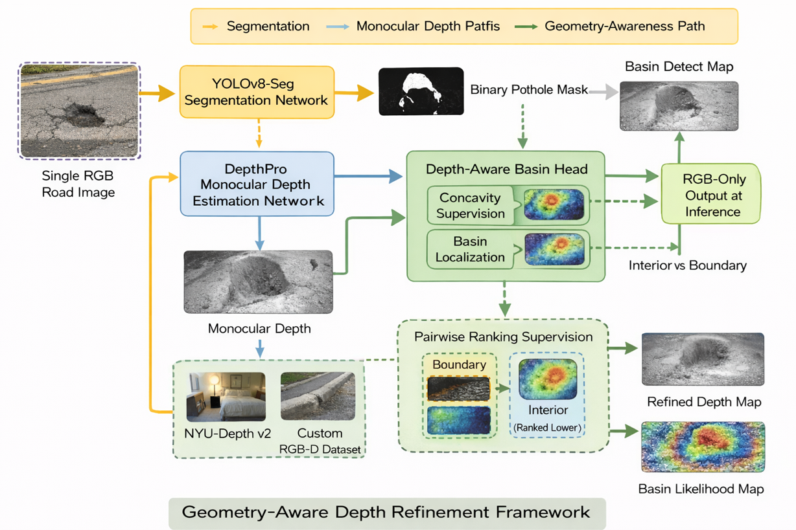

---

##### Download

+ [Paper](POTDEPTH___Shared.pdf)
<!-- + [Code]() -->
+ [Data](https://www.kaggle.com/datasets/mahyeks/pothrgbd-rgb-and-depth-images-of-potholes)

---

##### Abstract

Geometric analysis of potholes from monocular images plays a major role in the evaluation of road infrastructure, but still poses a problem due to the uncertainty of depth information for the road surface. Some traditional monocular depth estimation techniques emphasize the precision of depth measurement while neglecting the relative geometric structure of potholes in the presence of accompanying phenomena like shadows, reflective surfaces, and textureless regions. To address these issues, this paper proposes PotDEPTH, a geometry-informed depth refinement framework that formulates local pothole geometry as a depth-aware basin localization problem on top of a pothole-domain-adapted monocular depth model. The monocular depth model is fine-tuned on the POTHRGBD dataset to make it robust to pothole-specific tasks. In order to explicitly represent the depressed basin structure of potholes, a geometry-aware representation is utilized, weak supervision cues are included for identifying basin interiors, and a pairwise ranking constraint that distinguishes basin likelihood between basin interiors and pothole boundaries. The resulting geometry-aware representation is designed to preserve local depth structure even when absolute monocular depth is affected by shadows, textureless pavement, and depth noise. The approach is validated by experimental results as well as a custom-made depth dataset, to attest both metric accuracy and basin-level structural consistency. Compared with the state-of-the-art depth estimation techniques, PotDEPTH reduces MSE by 26.7% and Abs Rel by 20.8%, while demonstrating improved pothole-centric geometric consistency.

---

##### Figure 1: System Architecture (placeholder)



---

##### Citation

Varathakumaran, A., Namachivayam, A., Paramanandham, N. (2026). *PotDEPTH: Depth Aware Basin Localization for Accurate Pothole Geometry Estimation in ADAS*. ICT Express.

```latex
@article{Varathakumaran2026PotDEPTH,
  author  = {Aswinkumar Varathakumaran and Abirami Namachivayam and Nirmala Paramanandham},
  title   = {PotDEPTH: Depth Aware Basin Localization for Accurate Pothole Geometry Estimation in ADAS},
  journal = {ICT Express},
  year    = {2026}
}
```